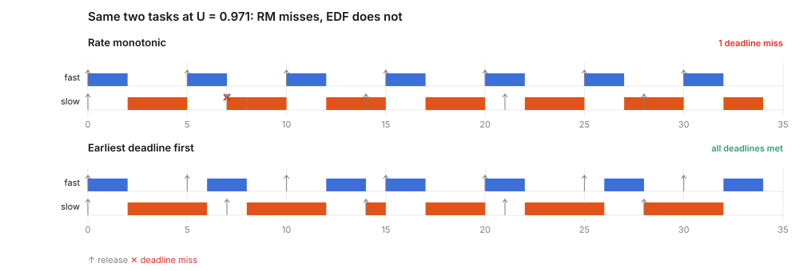
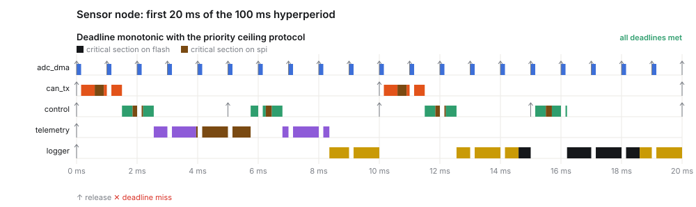

# rtsched

**Will your RTOS tasks meet their deadlines, and how much CPU can you take away before they don't?**

`rtsched` is a small, dependency-free Python tool for the questions that come up when sizing firmware on an RTOS:

- **Exact analysis:** response-time analysis for fixed priorities, with blocking under the priority ceiling protocol, and the processor-demand test for EDF.
- **Priority assignment:** rate-monotonic, deadline-monotonic, and Audsley's optimal algorithm.
- **Sizing:** the largest factor by which all WCETs can grow (or the CPU clock can drop) while everything stays schedulable.
- **Simulation:** an event-driven preemptive scheduler with resource ceilings, producing Gantt charts as SVG.

The analysis and the simulator are checked against each other on hundreds of random task sets.

[](https://github.com/dusancorlija/rtsched/actions/workflows/ci.yml)



## Example: a sensor node

`examples/sensor_node.toml` (times in µs): an ADC DMA handler, a control loop, a CAN transmitter with a deadline shorter than its period, telemetry and a flash logger. Three of them share an SPI bus.

```
$ rtsched analyze examples/sensor_node.toml --policy rm
task       prio      C       T       D     U      B       R   slack
adc_dma       0    150    1000    1000 0.150      0     150     850
control       1    900    5000    5000 0.180   1500    2850    2150
can_tx        2   1200   10000    4000 0.120   1500    MISS       -
...
RM: NOT schedulable
```

Utilisation is only 62 %, yet rate-monotonic fails. `can_tx` has to finish within 4 ms of release, but RM ranks it by its 10 ms period, below the control loop. It also suffers up to 1.5 ms of blocking while telemetry holds the SPI bus. Deadline-monotonic fixes the order:

```
$ rtsched analyze examples/sensor_node.toml --policy dm
task       prio      C       T       D     U      B       R   slack
adc_dma       0    150    1000    1000 0.150      0     150     850
can_tx        1   1200   10000    4000 0.120   1500    3300     700
control       2    900    5000    5000 0.180   1500    4350     650
telemetry     3   4000   50000   50000 0.080      0    8350   41650
logger        4   9000  100000  100000 0.090      0   24850   75150

DM: schedulable
WCET headroom: x1.148. Every task may take 14.8 % longer; equivalently the CPU clock could drop to 87.1 %.
```

The headroom line is the sizing answer. It comes from a binary search over a WCET scale factor with the exact test in the loop. That makes it useful for picking a clock frequency (power), or for knowing how much a feature may cost before something breaks. The binding constraint here is `can_tx` and `control` (650–700 µs of slack), not the CPU load.



```
$ rtsched simulate examples/sensor_node.toml --policy dm
task           jobs  max response  analytic bound
control          20          2550            4350
can_tx           10          1500            3300
telemetry         2          8350            8350
```

**Simulation shows what happened; analysis shows what can happen.** With synchronous release nobody holds the SPI lock when `can_tx` arrives, so the simulated response is well below the bound. The 1.5 ms blocking in the bound is the case where telemetry has just taken the lock. A test campaign alone would not find that case, and it is the reason to do the analysis.

## What is checked

The tests (`tests/test_rtsched.py`) are mostly properties that must hold between independent implementations:

| Property | How |
|---|---|
| RTA is exact without blocking | 300 random RM task sets (UUniFast). The simulated worst response at the critical instant equals the analytic one, task by task. |
| The blocking bound is safe | 200 random DM sets with shared resources: simulated response ≤ bound. |
| The EDF demand test is exact | 300 random constrained-deadline sets: the test says "schedulable" exactly when the simulation over a hyperperiod has no miss. Both outcomes are exercised. |
| Audsley is optimal | Without blocking, DM is optimal for D ≤ T, so Audsley must succeed exactly when DM does (300 random sets). |
| Sizing is tight | Schedulable at the reported factor, unschedulable at 1 % more. For EDF with implicit deadlines it equals 1/U. |

There are also known textbook values: R = 1, 3, 10 for (C, T) = (1, 4), (2, 6), (3, 12).

## Use as a library

```python
import rtsched as rt

tasks = [rt.Task("ctrl", wcet=900, period=5000),
         rt.Task("can", wcet=1200, period=10000, deadline=4000,
                 critical_sections=(rt.CriticalSection("spi", 300),))]
ranked = rt.deadline_monotonic(tasks)
for r in rt.rta(ranked):
    print(r.task.name, r.response, r.slack)

print(rt.scale_factor(ranked, rt.fp_schedulable))
open("gantt.svg", "w").write(rt.gantt([("DM", rt.simulate(ranked, "fp"))]))
```

## Model and limits

- Uniprocessor, preemptive, periodic tasks with synchronous release, constrained deadlines (D ≤ T), integer time
- Fixed priority uses the immediate priority ceiling protocol, the one behind OSEK/AUTOSAR resources. Each job is blocked at most once, for at most one critical section. Plain priority inheritance (as in FreeRTOS mutexes) can block a job once per resource, so this bound is not valid for it.
- Not modelled: release jitter, ISR and context-switch overhead (fold them into the WCETs), multicore, arbitrary deadlines (D > T)

## Install

```bash
pip install .          # Python 3.11+, no dependencies
rtsched analyze examples/sensor_node.toml --policy dm
rtsched simulate examples/rm_vs_edf.toml --policy rm --svg rm.svg
python -m unittest discover -s tests -t .
```

## License

MIT
